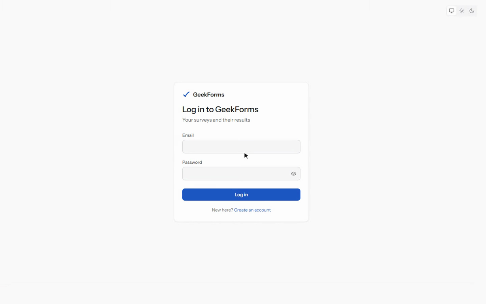

# GeekForms

A survey builder on the PERN stack (PostgreSQL, Express, React, Node), TypeScript end to end. Admins build surveys with conditional logic, respondents answer at a public link without logging in, and results land on an analytics dashboard.

**Live:** https://geekformss.vercel.app (register an account to try it; the API sleeps when idle, so the first request can take about a minute)

**Demo video** (1 min 46 s, click to watch on YouTube):

[](https://youtu.be/lyG5xYCGmnA)

## Features

- **Builder**: text, multiple choice, checkboxes and 1–5 rating questions. Add, duplicate, reorder (drag or buttons), mark required, live preview, autosave.
- **Conditional logic**: show a question when an earlier answer equals, includes, is at least/most, or is (not) answered. Chains hide correctly.
- **Public form**: rendered from the JSON schema, validated, with progress and resumable partial responses.
- **Analytics**: totals, completion rate, daily trend, per-option counts, rating averages and spread, searchable text answers. Filter by version and export CSV.
- **Server-side search**: the survey tables search and filter on the API, and the filter pills show live counts.
- **Bonus**: JWT with rotating refresh tokens, versioning, partial responses, rate limiting plus a honeypot field. Light and dark themes.

## Quick start

Needs Node 20+ and Docker (for Postgres; any Postgres 13+ works).

```bash
npm install
cp .env.example .env     # set JWT_SECRET and REFRESH_SECRET (32+ chars each)
npm run db:up            # Postgres on localhost:5433
npm run db:seed          # optional demo data
npm run dev              # API :4000, app :5173 (runs migrations first)
```

Demo login after seeding: `demo@geekforms.dev` / `demo12345`. Public form: http://localhost:5173/s/product-feedback-demo.
Every env variable is documented in [`.env.example`](.env.example) and validated at boot. The server won't start with missing or weak secrets.

| Command | What it does |
|---|---|
| `npm run dev` | Migrate, then run API and Vite |
| `npm test` | Unit tests for the shared validation and logic |
| `npm run check` | Type check, lint and formatting (a pre-commit hook lints staged files) |
| `npm run build` / `npm start` | Production build / one server for API and client |
| `npm run db:generate` / `db:migrate` | Create / apply Drizzle migrations |
| `npm run db:seed:reset` | Recreate the demo data |

## Stack and structure

- **Server**: Express 5, TypeScript (strict), Drizzle ORM, Zod, JWT, bcrypt, helmet, express-rate-limit.
- **Client**: React 18, TypeScript, Vite, Tailwind CSS v4, axios, lazy-loaded routes.
- **Shared**: `@survey/shared`, the schema validation and conditional logic used by both sides.

```
shared/    schema validation, visibility rules, answer validation (unit tested)
server/    src/modules/<domain>/ routes → controller → service (+ zod schema)
           auth · survey · analytics · public · response; drizzle/ holds generated migrations
client/    pages/ · components/common + feature folders · hooks/ · lib/ · types/
api-docs/  endpoint reference, one file per module
```

Only services touch the database. Every response uses `{ success, data, message, meta?, errors? }`, and validation failures return 422 with field errors.

## Key decisions

1. **One validation module** for builder, form and server, so their rules can't drift apart.
2. **Survey schema as JSONB with stable ids**: renames and reorders never break answers or conditions.
3. **Conditions point only at earlier questions**: no cycles, visibility in one forward pass.
4. **Immutable published versions**: each response keeps its version, so edits never rewrite history.
5. **Responses in their own table**: answers keyed by question id, hidden answers stripped on the server.
6. **Analytics in SQL**: a fixed 5 queries per dashboard, whatever the question count.
7. **Resume tokens**: random, only a hash stored, one row per respondent.
8. **Sessions**: 15-minute access token in memory, plus a 7-day refresh token in an httpOnly cookie. The refresh token rotates on every use; reusing an old one logs out every device on that login. Logout revokes them all.
9. **Server-side search**: one set of conditions drives both the result page and the per-filter counts (computed in one aggregate query).
10. **Soft delete**: data is kept and the link stays reserved.
11. **Security**: no default secrets, helmet with a Content Security Policy, every query scoped to its owner (404 for other people's surveys), rate limits, escaped searches and CSV cells.

## Deployment

Live setup: **Vercel** (frontend) → **Render** (API, Docker) → **Neon** (Postgres).

- **Vercel** builds the client (`vercel.json`) and proxies `/api/*` to Render, so the browser sees one origin and the `SameSite=Strict` refresh cookie keeps working.
- **Render** runs the multi-stage `Dockerfile` (non-root, health check) from `render.yaml`. Set `DATABASE_URL` (Neon pooled URL) and `DATABASE_URL_UNPOOLED` (direct URL, used for migrations, which run at boot). `TRUST_PROXY=2` covers the Vercel and Render hops.
- **Neon** is linked with `neon.ts` (`neon init` / `neon deploy`).

Self-hosting instead: Express also serves the built app, so the image runs alone. `docker-compose.prod.yml` runs Postgres, then a migration job, then the API.

## API

Full reference in [`api-docs/`](api-docs/README.md). Main routes, all under `/api/v1`:

| Route | Purpose |
|---|---|
| `POST /auth/register` · `/login` · `/refresh` · `/logout` | Sessions |
| `GET /surveys/search` · `/surveys/search/facets` | Table search and filter counts |
| `GET POST /surveys` · `GET PATCH DELETE /surveys/:id` | List, create, read, save draft, delete |
| `POST /surveys/:id/publish` · `PATCH /surveys/:id/status` | Publish a version, close or reopen |
| `GET /surveys/:id/analytics` · `/responses.csv` | Results and CSV export |
| `GET /public/surveys/:slug` · `PUT …/draft` · `POST …/responses` | Public form, autosave, submit |

## Testing

- `shared/test`: 12 unit tests (validation, condition order, visibility, every operator).

## Trade-offs

- **Anonymous respondents**: rate limits instead of one-response-per-person.
- **One condition per question**, earlier questions only. AND/OR groups would fit the schema later.
- **Drafts save leniently, publishing is strict.**
- **Abandoned partials expire** after `PARTIAL_TTL_DAYS` (30) and never count as in progress.
- **No analytics caching yet**: indexes cover tens of thousands of responses. Beyond that, materialised views.
- **Hand-built SVG charts**, no chart library.
- **Native drag and drop**, with buttons for touch and keyboard.
